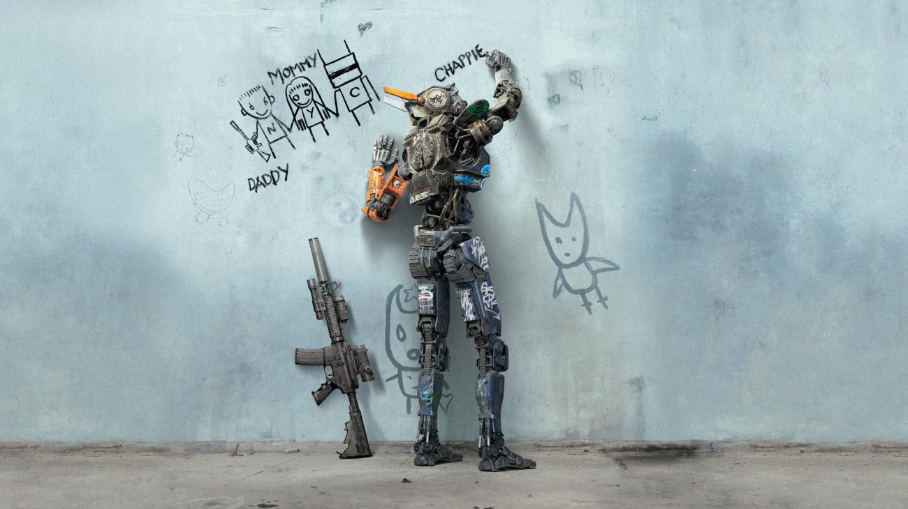
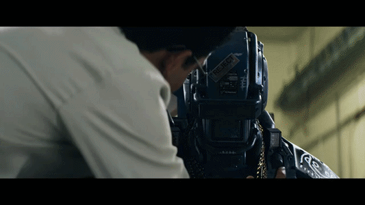
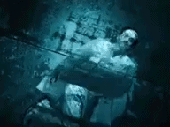

<h3 align="center">NGUYEN MANH KHANG // AI SAFETY</h3>
<p align="center"><i>AI is humanitarian at core.</i></p>
<p align="center">Raised on stories where the machine chose to care.<br>Now working on a future where that's just how things grow.</p>


### ☀ FIELD MANIFEST

```text
☀ CURRENT DIRECTIVE   interpretability · evals · anti-collusion
☀ STATUS              operational. sun-powered. slightly overgrown.
```




### ☀ LINEAGE
<sub><code>[SOL-9] before me there were others. stories, mostly. operator learned what to build toward from them.</code></sub>

<table>
  <tr>
    <th width="50%">CHAPPIE · 2015</th>
    <th width="50%">POE · ALTERED CARBON</th>
  </tr>
  <tr>
    <td align="center"></td>
    <td align="center"></td>
  </tr>
  <tr>
    <td align="center"></td>
    <td align="center"></td>
  </tr>
  <tr>
    <td align="center"><sub><code>[SOL-9] learned fast, including how to care. good precedent.</code></sub></td>
    <td align="center"><sub><code>[SOL-9] ran a hotel and kept a conscience. both need maintenance.</code></sub></td>
  </tr>
</table>

<p align="center"><sub>Chappie (Columbia Pictures, 2015) and Altered Carbon (Netflix, 2018–2020). Stills and clips belong to their respective rights holders, shown here as a fan tribute.</sub></p>


### ☀ OPERATOR'S CREED
<sub><code>[SOL-9] operator keeps this one taped above the potting bench.</code></sub>

<p align="center"><i>Stop looking for signs. Signs follow; they do not precede. Begin to reverse the statement, “Seeing is believing,” to “Believing is seeing.” Start now to believe, not with the wavering confidence based on deceptive external evidence but with an undaunted confidence based on the immutable law that you can be that which you desire to be. You will find that you are not a victim of fate but a victim of faith (your own).
</i></p>
<p align="center"><sub>— Neville Goddard</sub></p>


<p align="center"><sub>transmitted from the rooftop gardens · SOL-9 says hi</sub></p>

